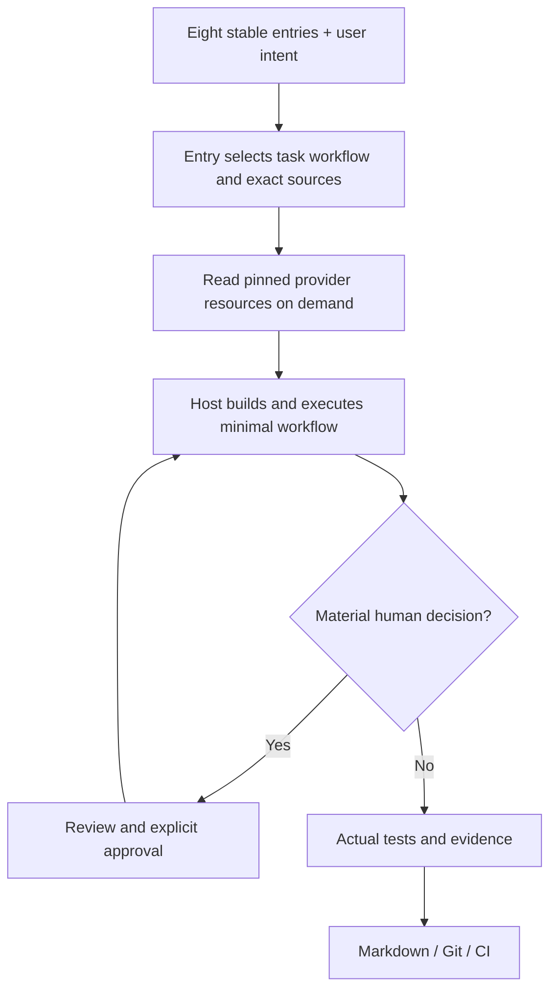

# Architecture

Two registry files: exact upstream lock and unified capability inventory with primary/complement choices and search hints. Each entry has a human-readable task workflow document with required/conditional upstream source keys; the host selects applicable sections and adapts the method. No persistent execution engine or rigid per-step state machine. Python is used only for installation, dependency integrity, inventory checks, Markdown validation and legacy migration. Host agent owns semantic routing and execution. Markdown is authoritative; Git retains history. Human decisions and independent CI protect accepted behavior. This is a cooperative skill, not a security boundary.
