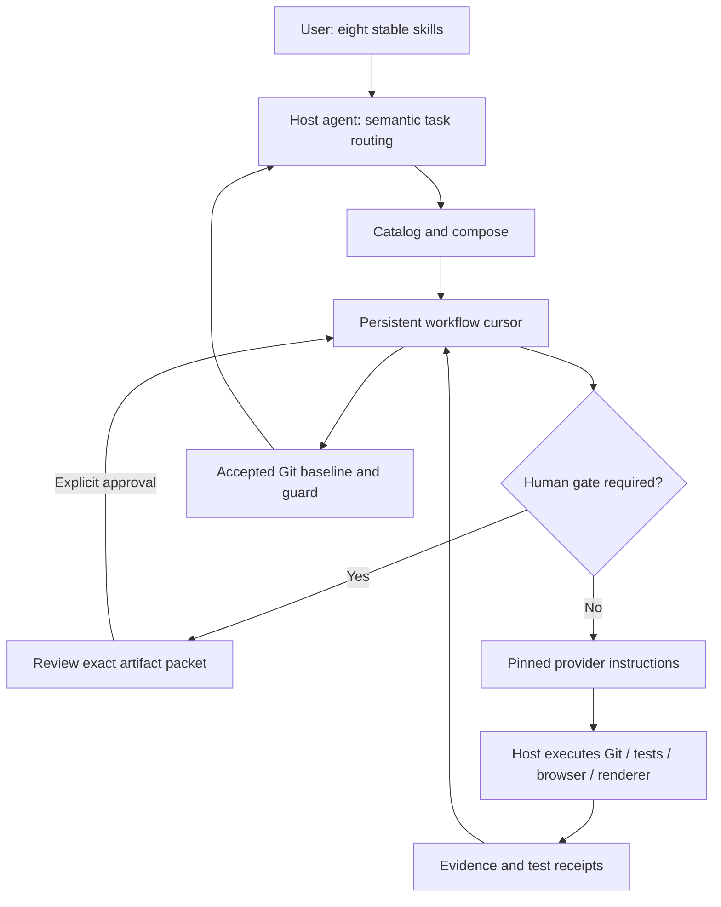

# Trellis architecture

## Why this design?

- **Stable user layer:** exactly eight `SKILL.md` entry points. The host understands the natural-language input and chooses a registered route. A single route is not a whole mandatory lifecycle; composite requests select a sequence of templates.
- **Registry:** `upstream-capabilities.json` inventories pinned source artifacts; `coverage.json` maps them to a canonical route. `capability-registry.json` marks primary providers and complements; `routing-registry.json` carries steps, preconditions, provider keys, gate names and task examples. `dependencies.lock.json` records concrete commits and discovered `SKILL.md` paths. All five provider trees are installed privately, not made into competing user skill menus.
- **Runtime:** Python standard library CLI; `Project` owns durable state, approved-artifact hashes, active-run cursor, exact requirement records, actual test receipts and protected file hashes. Changes are checked at step preflight/completion. A scope and exact allowed path set restrict the managed operation. This is a cooperative runtime, not OS sandboxing.
- **Host boundary:** the agent actually reads and follows provider procedures and runs their tools. There is no invented cross-host Skill RPC or independent LLM service. Native-only capabilities need the native tool/host. A blocked provider is reported, not counted as successful execution.

## Project lifecycle

Requirements → design approval → interface approval → public code skeleton approval → sample-based full-path contract test → plan approval → module slices → actual acceptance → baseline → later regression/controlled change.

Keep current requirement views, current approved design, machine-readable contracts/examples, concise mechanism explanations and a small set of evidence. Use Git to preserve old content, not multiple full documentation copies. Human approvals apply at meaningful abstraction boundaries and whenever protected behavior or evaluation changes.

## State and trust

`.trellis/state.json` holds canonical records, workflow/gate events and baseline manifests; the two numbered Markdown requirement views are generated projections. Do not manually edit the generated views. Existing requirement docs are never overwritten silently. Active workflow snapshots are released after completion. `.trellis/receipts/` holds command evidence; `.trellis/logs/` holds local potentially sensitive logs. Hashes detect drift; they are not signatures. Enforce independent protected branches, review of evaluator/state changes and CI in production. Native tools, network, model behavior and semantic correctness require integration testing on actual hosts.
